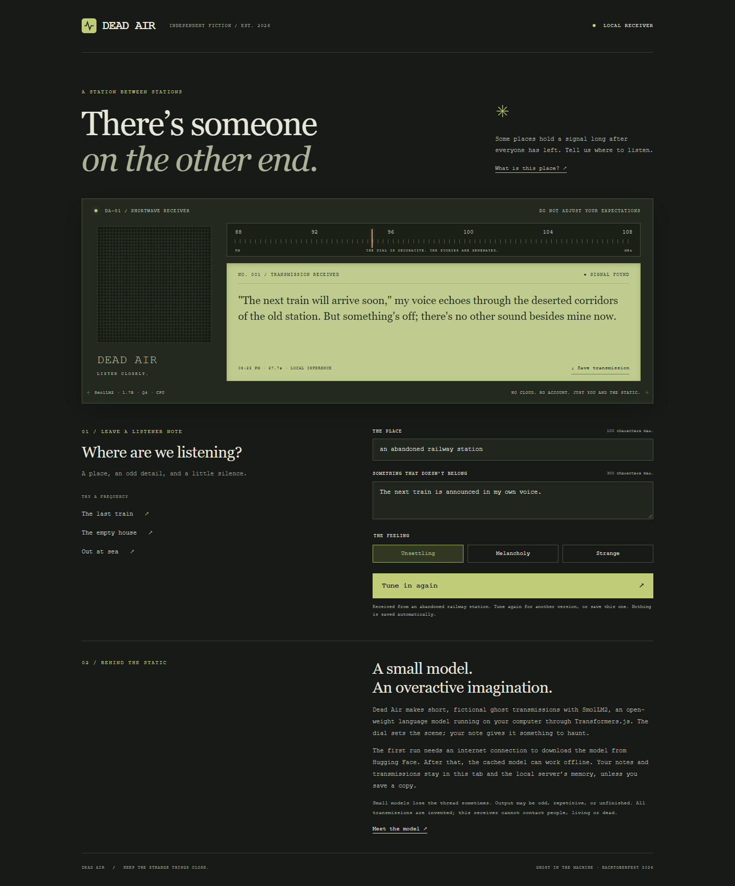

# Dead Air

A station between stations. Leave a place and an odd detail; a small language model imagines a short ghost transmission from the other end.

Built for [Hacktoberfest Week 4: Ghost in the Machine](https://dev.to/challenges/hacktoberfest-week4-2026-10-26), on October 31, 2026.



[Recorded demo](docs/demo.mp4) · [Verification notes](docs/verification.md)

## Run the radio

Install Node.js 20.9 or newer. Allow a few GB of disk space for dependencies and the model, and a few GB of available RAM. No GPU, API key, or hosted inference account is required.

```sh
npm ci
npm run model:download
npm start
```

Open **http://127.0.0.1:8808**. Set a place, add something that doesn't belong, choose a feeling, and press **Tune in**. The examples fill the controls; they are starting points, not prerecorded outputs. **Save transmission** downloads the text along with its prompt, timestamp, and model name.

The download command caches the model before you start. You can also skip it and let the first transmission download the model. The quantized ONNX weights are about 1.41 GB; download and generation time depend on your connection and CPU. The page reports loading progress. The server accepts one generation at a time.

After the model is cached, the app can generate without internet. Everything needed for the interface is served locally, including the fonts supplied by your operating system. To force cache-only model loading in PowerShell:

```powershell
$env:OFFLINE = '1'
npm start
```

An uncached model cannot load in offline mode. Stop the server and remove the flag with `Remove-Item Env:OFFLINE` before downloading. To change the port, set `PORT` before starting.

## What runs where

The browser sends your note to a Node HTTP server bound to `127.0.0.1`. The server runs **HuggingFaceTB/SmolLM2-1.7B-Instruct**, quantized to **q4**, using **Transformers.js** and **ONNX Runtime** on the CPU. The place, detail, and mood go into a short chat prompt. One short example sets the style; sampling produces the transmission. There are no fixed story responses or remote generation fallbacks.

The interface deliberately resembles an old shortwave receiver. Its dial is decorative; it does not receive real radio. The stories are fiction and the system cannot contact anyone.

Notes and outputs are not written to a database or log. They stay in the tab and server memory unless you choose to save a text file. The initial model download contacts Hugging Face and its file-delivery infrastructure. There are no analytics or third-party page assets. The local server is intended for one person's computer, not as a public hosting service.

## Limits

This is a 1.7-billion-parameter model. It can ignore a detail, repeat itself, write awkwardly, or stop mid-sentence at the 140-token cap. Tune again if an attempt doesn't work. The system prompt requests short, non-graphic fiction, but generated content is not moderated by a separate classifier. It is a creative toy, not a factual source or a way to impersonate a real person.

The app keeps only the most recent transmission. Save it before tuning again or closing the page. No data is restored after a restart.

## Checks and submission materials

```sh
npm test
```

The HTTP tests use an injected generator to exercise validation, request limits, host/origin checks, concurrent requests, and recovery after inference failure. They do not claim to test model quality. Real model and browser observations belong in [docs/verification.md](docs/verification.md).

- [DEV post draft](docs/dev-submission.md)
- [Official template, preserved verbatim](docs/official-submission-template.md)
- [Submission checklist](docs/submission-checklist.md)
- [Demo walkthrough](docs/demo-script.md)

No build step is needed. `public/` contains the interface, `server.js` owns HTTP handling, and `model.js` owns model loading and generation.

## Credits and licensing

The application code is MIT licensed. The model has its own Apache-2.0 license:

- [SmolLM2-1.7B-Instruct](https://huggingface.co/HuggingFaceTB/SmolLM2-1.7B-Instruct), by Hugging Face's SmolLM team. Its model card describes training, evaluation, and limitations.
- [Transformers.js](https://github.com/huggingface/transformers.js), Apache-2.0, for local inference and chat tokenization.
- [ONNX Runtime](https://github.com/microsoft/onnxruntime), MIT, for CPU execution.

The design uses CSS, an original small waveform icon, and installed Georgia/Courier fonts. No stock art, copied story collection, or synthetic testimonials. AI assistance was used during implementation and verification; the generated transmissions come from the actual local model.

If any changes are made after **October 31, 2026, 11:59 p.m. PDT**, list their dates and scope here, as the challenge requires. No post-deadline changes are recorded at the time this file was created.
